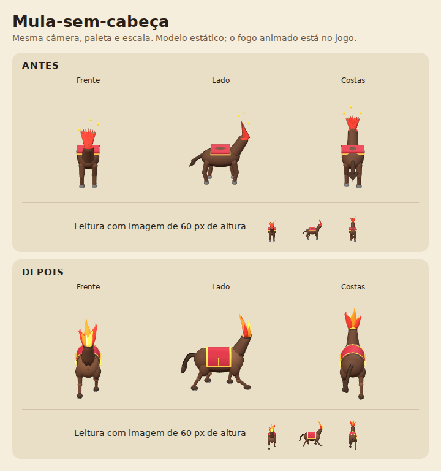
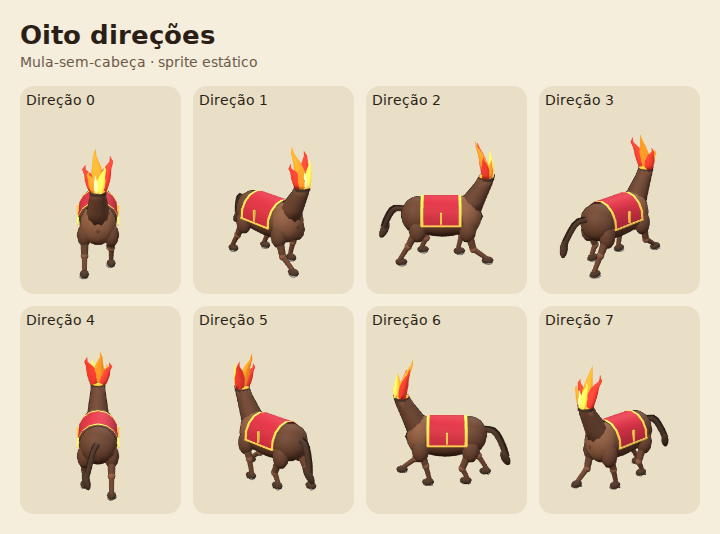
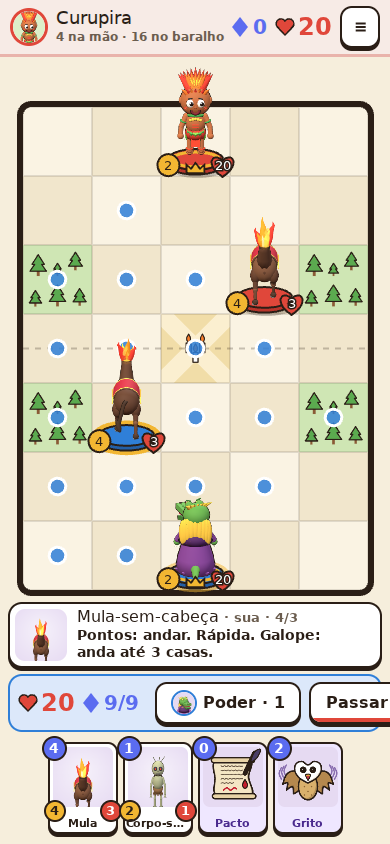

# ASTRA — etapa 1: Mula-sem-cabeça

Branch: `peleja/astra-figs`, criada a partir de `peleja/prototype` no commit
`3f1c89611525081bdc81b60b847a31cf1c928f81`.

Esta entrega modifica **apenas a Mula**. Nenhum dos outros 14 personagens recebeu
formas ou efeitos novos. A próxima etapa fica aguardando revisão visual desta.

## Antes e depois



- Corpo alongado, peito e anca definidos; quatro patas articuladas em pose de galope.
- Manta vermelha acompanha o dorso e cai nas laterais, com acabamento dourado.
- Cascos escuros e ferraduras abertas em U; cauda curva com tufo.
- Pescoço contínuo, sem cabeça, terminando em fogo com pontas curvas e núcleo claro.
- Chamas e brasas animadas no canvas 2D; brilho no pescoço e poeira ao mover.





[Folha completa das miniaturas](../shots/figsheet.png).

## Contratos e limites

- `src/core.js` permanece **idêntico byte a byte** à origem; regras intactas.
- `FIGS.sprite`, `dirOf`, `ok`, `has` e `DEF[id].build(K)` preservados.
- `FIGS.anchors(id, dir)` projeta os pontos locais pela mesma câmera do sprite,
  incluindo escala e rotação. Coordenadas na imagem canônica 256×320, em cache por direção.
- Câmera, resolução, orientação e alinhamento dos pés a 88,5% mantidos.
- Mula: **7.144 triângulos, incluindo todas as malhas de contorno**; teto de 8.000.
- Three.js **r128**; geometria e efeitos procedurais, sem novos assets externos.
- Pool de `FX`: **120 partículas**, prealocadas, com até 12 chamas/brasas por Mula.
  O loop de FX reutiliza partículas/emissores, sem criar objetos por quadro;
  sprites e projeções são criados apenas no primeiro uso de cada direção.
- Partículas pausam no menu, passagem de jogador e aba oculta. Com movimento
  reduzido, não há chamas/brasas/poeira animadas; apenas brilho estático e o sprite.
- Ataque, vida e selos são desenhados em uma segunda passagem, depois de todos os
  bonecos e seus efeitos, evitando que uma Mula cubra os números de outra peça.
- Emissores são limpos ao sair/reiniciar, trocar de jogador ou redimensionar.
- `build.py` embute `src/fx.js`; `dist/peleja.html` foi atualizado. O HTML joga
  offline usando os fallbacks de fonte existentes e mantém o fallback 2D sem WebGL.

## Verificação

Executados:

```sh
python3 build.py
node tools/figsheet.js
node tools/regras.js
node tools/telas.js
node tools/mula.js
```

- Regras: **33 cenários passaram, zero falhas**.
- Folha completa e 14 telas do fluxo original geradas sem erros de JavaScript.
- `tools/mula.js`: orçamento de triângulos com contornos; oito direções sem cortes;
  emissores sobre fogo visível; cache de sprites/âncoras; comparação pixel a pixel
  de **112 sprites dos outros personagens, todos idênticos** à origem.
- FX exercitado com 35 emissores simultâneos; limite de 120, pausa, aba oculta,
  limpeza de emissor removido, poeira e mudança de preferência de movimento.
- Partida no viewport de celular 390×844, toque/seleção e movimento da Mula.
  Recursos HTTP bloqueados para verificar funcionamento offline; fallback sem
  WebGL também exercitado. Nenhum erro de JavaScript.
- [Dados da verificação](../shots/mula-qa.json).

As capturas foram inspecionadas em Chromium com renderização por software.
O viewport de celular é uma simulação; não houve teste em aparelho físico.

No ambiente desta entrega foi necessário fornecer um Chromium headless local e
ajustar seus flags de execução via preload de Playwright. Isso não altera o HTML
nem adiciona dependência de navegador ao jogo. Os comandos acima usam a instalação
normal de Playwright/Chromium em ambientes que a tenham disponível.
