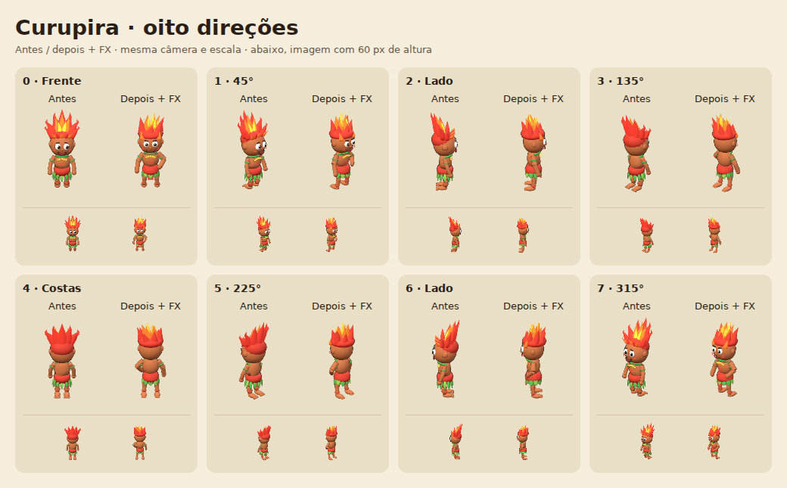

# ASTRA — revisão sequencial dos personagens

Base desta revisão: `c91f57c`, a `peleja/prototype` atual em 13/10/2026.
Ela já incorporava a Mula e o Saci do Astra, a remodelagem dos demais personagens
e os ajustes de interface e regras feitos em outros commits. Essas mudanças
foram preservadas; esta revisão não edita `src/core.js`.

Cada etapa compara oito direções com o commit imediatamente anterior, incluindo
uma amostra a 60 px de altura, confere os outros 112 sprites e verifica orçamento,
âncoras, FX, pausa, movimento reduzido, toque, movimento e partida offline.
Imagens foram inspecionadas em Chromium com renderização por software; o celular
é um viewport simulado, sem teste em aparelho físico.

## Curupira — 7.904 triângulos (antes: 13.064)

Cabelo contínuo em três camadas de mechas curvas, com núcleo amarelo e fogo
animado ancorado. Pose assimétrica, saia de folhas largas e pés voltados para
trás. Pele marrom e paleta mantidas. Também removidas as alocações de arrays e
função auxiliar por chamada de `FX.paint` introduzidas na integração anterior.

[Jogo](../shots/jogo-curupira.png) · [QA](../shots/curupira-qa.json)

Reproduzir: `node tools/personagem.js curupira c91f57c`.
