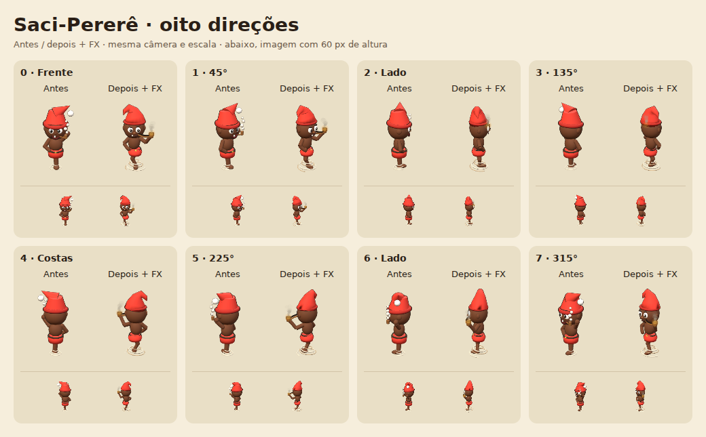
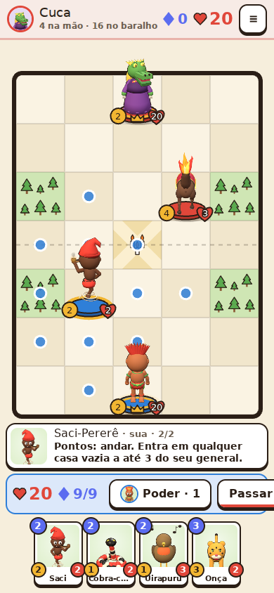

# ASTRA — etapa 2: Saci-Pererê

Base de revisão: `4b80fe7`. A `peleja/prototype` atual (`4f28a72`, Mula)
é ancestral desta etapa na branch `peleja/astra-figs`.

- Uma única perna flexionada; braço na cintura e mão segurando o cachimbo.
- Carapuça vermelha com dobra descendente; expressão travessa e contorno fino.
- Cachimbo com haste curva, bojo aberto, brasa e emissor na abertura.
- Dois fios espirais de vento deixam a perna visível.
- Fumaça está fora do modelo: `FIGS.anchors(...).smoke` projeta a abertura pela
  mesma câmera e direção do sprite; `FX` faz subir, crescer, oscilar e desaparecer.
- Brilho na brasa e poeira no evento de movimento.

O modelo tem **6.760 triângulos com contornos** (limite: 8.000). Mantidos a
paleta, Three r128, câmera, alinhamento a 88,5%, sprites em cache e HTML offline.
O pool continua com 120 partículas, compartilhado com a Mula, sem criar objetos
no loop de FX. A fumaça pausa com aba oculta e desaparece com movimento reduzido;
nesse modo resta o brilho estático. Números seguem na passagem final do desenho.

Verificação: `python3 build.py`, `node tools/figsheet.js`, `node tools/regras.js`,
`node tools/telas.js` e `node tools/personagem.js saci 4b80fe7`.
O teste específico cobre as oito direções sem cortes, âncoras em cache, orçamento,
**112 sprites dos demais personagens idênticos**, fumaça subindo/crescendo/
desvanecendo/oscilando, pool sob carga, pausa, aba oculta, limpeza, poeira,
movimento reduzido, toque, movimento e partida offline sem erros JavaScript.

[Dados da verificação](../shots/saci-qa.json). Capturas inspecionadas no Chromium
com renderização por software; viewport móvel simulado, sem aparelho físico.
`src/core.js` permaneceu idêntico byte a byte.
